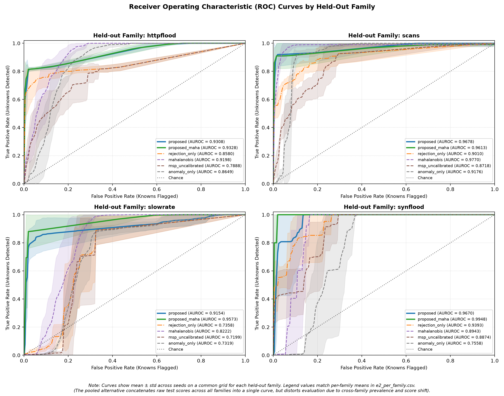
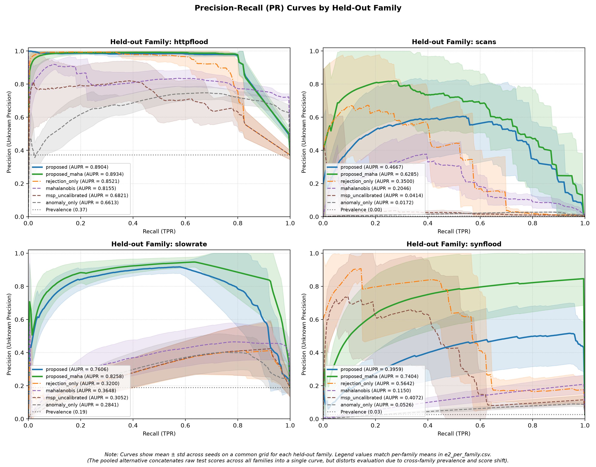
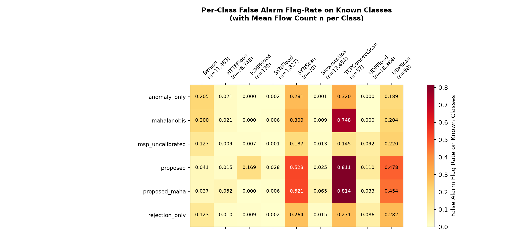
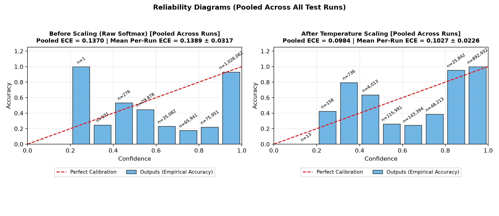
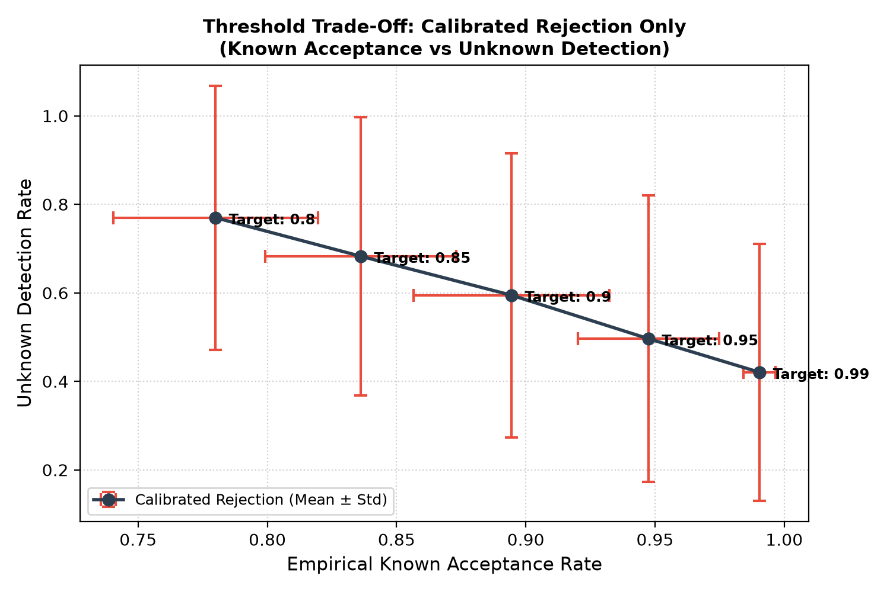

# Experiment Evaluation Report

Source Results Directory: `results_final`

Model: `rf`

## 1. Overall Open-Set Detection Performance

Averaged across all holdout families and random seeds.

| Method | Auroc | Aupr | Unknown Precision | Unknown Detection Rate | Known Fpr | Open Set F1 |
| --- | --- | --- | --- | --- | --- | --- |
| **anomaly_only** | 0.8175 ± 0.0911 | 0.2538 ± 0.2690 | 0.1183 ± 0.2193 | 0.0635 ± 0.1132 | 0.0432 ± 0.0265 | 0.6542 ± 0.0735 |
| **classifier_only** | — | — | 0.0000 ± 0.0000 | 0.0000 ± 0.0000 | 0.0000 ± 0.0000 | 0.7083 ± 0.0337 |
| **energy** | n/a: no logits | n/a: no logits | n/a: no logits | n/a: no logits | n/a: no logits | n/a: no logits |
| **mahalanobis** | 0.9033 ± 0.0665 | 0.3750 ± 0.2835 | 0.2311 ± 0.3511 | 0.3126 ± 0.3803 | 0.0453 ± 0.0324 | 0.6484 ± 0.0717 |
| **msp_uncalibrated** | 0.8170 ± 0.0832 | 0.3590 ± 0.2636 | 0.2333 ± 0.3187 | 0.3030 ± 0.2444 | 0.0550 ± 0.0266 | 0.7324 ± 0.0380 |
| **proposed** | 0.9453 ± 0.0435 | 0.6284 ± 0.2494 | 0.5253 ± 0.3579 | 0.8424 ± 0.2169 | 0.0552 ± 0.0339 | 0.7027 ± 0.0527 |
| **proposed_maha** | 0.9616 ± 0.0371 | 0.7720 ± 0.1879 | 0.5438 ± 0.3483 | 0.9028 ± 0.1003 | 0.0491 ± 0.0271 | 0.7259 ± 0.0274 |
| **rejection_only** | 0.8585 ± 0.0908 | 0.5216 ± 0.2506 | 0.3532 ± 0.3505 | 0.4963 ± 0.3233 | 0.0531 ± 0.0277 | 0.7454 ± 0.0448 |

## 2. Per-Family Open-Set Detection Breakdown

| Family | Method | Auroc | Aupr | Unknown Precision | Unknown Detection Rate | Known Fpr | Open Set F1 |
| --- | --- | --- | --- | --- | --- | --- | --- |
| httpflood | `anomaly_only` | 0.8649 ± 0.0387 | 0.6613 ± 0.0652 | 0.4549 ± 0.1982 | 0.0840 ± 0.1161 | 0.0399 ± 0.0243 | 0.6228 ± 0.0907 |
| httpflood | `classifier_only` | — | — | 0.0000 ± 0.0000 | 0.0000 ± 0.0000 | 0.0000 ± 0.0000 | 0.6925 ± 0.0276 |
| httpflood | `energy` | n/a: no logits | n/a: no logits | n/a: no logits | n/a: no logits | n/a: no logits | n/a: no logits |
| httpflood | `mahalanobis` | 0.9198 ± 0.0284 | 0.8155 ± 0.0470 | 0.8196 ± 0.0599 | 0.3441 ± 0.1495 | 0.0505 ± 0.0454 | 0.6432 ± 0.0422 |
| httpflood | `msp_uncalibrated` | 0.7888 ± 0.0513 | 0.6821 ± 0.1166 | 0.6757 ± 0.3222 | 0.4033 ± 0.2489 | 0.0549 ± 0.0259 | 0.7612 ± 0.0444 |
| httpflood | `proposed` | 0.9308 ± 0.0088 | 0.8904 ± 0.0083 | 0.8720 ± 0.0578 | 0.8182 ± 0.0184 | 0.0743 ± 0.0384 | 0.6921 ± 0.0185 |
| httpflood | `proposed_maha` | 0.9328 ± 0.0126 | 0.8934 ± 0.0075 | 0.8708 ± 0.0628 | 0.8177 ± 0.0173 | 0.0749 ± 0.0410 | 0.7080 ± 0.0224 |
| httpflood | `rejection_only` | 0.8580 ± 0.0267 | 0.8521 ± 0.0360 | 0.9009 ± 0.0647 | 0.6736 ± 0.2474 | 0.0507 ± 0.0320 | 0.7957 ± 0.0365 |
| scans | `anomaly_only` | 0.9176 ± 0.0168 | 0.0172 ± 0.0017 | 0.0082 ± 0.0053 | 0.1662 ± 0.1552 | 0.0447 ± 0.0282 | 0.7141 ± 0.0186 |
| scans | `classifier_only` | — | — | 0.0000 ± 0.0000 | 0.0000 ± 0.0000 | 0.0000 ± 0.0000 | 0.7383 ± 0.0103 |
| scans | `energy` | n/a: no logits | n/a: no logits | n/a: no logits | n/a: no logits | n/a: no logits | n/a: no logits |
| scans | `mahalanobis` | 0.9770 ± 0.0186 | 0.2046 ± 0.0618 | 0.0646 ± 0.0289 | 0.8937 ± 0.0813 | 0.0418 ± 0.0260 | 0.7352 ± 0.0310 |
| scans | `msp_uncalibrated` | 0.8718 ± 0.0309 | 0.0414 ± 0.0389 | 0.0253 ± 0.0168 | 0.3712 ± 0.1893 | 0.0513 ± 0.0277 | 0.7469 ± 0.0157 |
| scans | `proposed` | 0.9678 ± 0.0301 | 0.4667 ± 0.1928 | 0.0857 ± 0.1135 | 0.9157 ± 0.0857 | 0.0603 ± 0.0375 | 0.7509 ± 0.0367 |
| scans | `proposed_maha` | 0.9613 ± 0.0479 | 0.6285 ± 0.2181 | 0.0646 ± 0.0370 | 0.9095 ± 0.1009 | 0.0432 ± 0.0179 | 0.7498 ± 0.0186 |
| scans | `rejection_only` | 0.9010 ± 0.0592 | 0.3500 ± 0.1525 | 0.0585 ± 0.0658 | 0.6562 ± 0.1465 | 0.0523 ± 0.0282 | 0.7539 ± 0.0212 |
| slowrate | `anomaly_only` | 0.7319 ± 0.0469 | 0.2841 ± 0.1008 | 0.0094 ± 0.0142 | 0.0020 ± 0.0039 | 0.0439 ± 0.0336 | 0.6738 ± 0.0709 |
| slowrate | `classifier_only` | — | — | 0.0000 ± 0.0000 | 0.0000 ± 0.0000 | 0.0000 ± 0.0000 | 0.7312 ± 0.0242 |
| slowrate | `energy` | n/a: no logits | n/a: no logits | n/a: no logits | n/a: no logits | n/a: no logits | n/a: no logits |
| slowrate | `mahalanobis` | 0.8222 ± 0.0535 | 0.3648 ± 0.1051 | 0.0345 ± 0.0387 | 0.0062 ± 0.0057 | 0.0468 ± 0.0377 | 0.6372 ± 0.0550 |
| slowrate | `msp_uncalibrated` | 0.7199 ± 0.0680 | 0.3052 ± 0.1312 | 0.0248 ± 0.0283 | 0.0061 ± 0.0060 | 0.0598 ± 0.0358 | 0.7257 ± 0.0226 |
| slowrate | `proposed` | 0.9154 ± 0.0576 | 0.7606 ± 0.1415 | 0.8098 ± 0.1231 | 0.8289 ± 0.1457 | 0.0497 ± 0.0358 | 0.6961 ± 0.0533 |
| slowrate | `proposed_maha` | 0.9573 ± 0.0402 | 0.8258 ± 0.1381 | 0.8268 ± 0.1012 | 0.8840 ± 0.1264 | 0.0373 ± 0.0065 | 0.7366 ± 0.0187 |
| slowrate | `rejection_only` | 0.7358 ± 0.0631 | 0.3200 ± 0.1330 | 0.1941 ± 0.1773 | 0.0291 ± 0.0168 | 0.0557 ± 0.0356 | 0.7223 ± 0.0187 |
| synflood | `anomaly_only` | 0.7558 ± 0.0787 | 0.0526 ± 0.0106 | 0.0007 ± 0.0011 | 0.0017 ± 0.0027 | 0.0444 ± 0.0282 | 0.6063 ± 0.0548 |
| synflood | `classifier_only` | — | — | 0.0000 ± 0.0000 | 0.0000 ± 0.0000 | 0.0000 ± 0.0000 | 0.6710 ± 0.0106 |
| synflood | `energy` | n/a: no logits | n/a: no logits | n/a: no logits | n/a: no logits | n/a: no logits | n/a: no logits |
| synflood | `mahalanobis` | 0.8943 ± 0.0395 | 0.1150 ± 0.0364 | 0.0057 ± 0.0085 | 0.0064 ± 0.0069 | 0.0422 ± 0.0276 | 0.5781 ± 0.0533 |
| synflood | `msp_uncalibrated` | 0.8874 ± 0.0435 | 0.4072 ± 0.1862 | 0.2074 ± 0.1539 | 0.4313 ± 0.1920 | 0.0539 ± 0.0241 | 0.6956 ± 0.0330 |
| synflood | `proposed` | 0.9670 ± 0.0455 | 0.3959 ± 0.1738 | 0.3336 ± 0.1953 | 0.8069 ± 0.4304 | 0.0363 ± 0.0180 | 0.6718 ± 0.0662 |
| synflood | `proposed_maha` | 0.9948 ± 0.0074 | 0.7404 ± 0.2281 | 0.4132 ± 0.1367 | 1.0000 ± 0.0000 | 0.0409 ± 0.0176 | 0.7091 ± 0.0276 |
| synflood | `rejection_only` | 0.9393 ± 0.0421 | 0.5642 ± 0.1720 | 0.2594 ± 0.1313 | 0.6263 ± 0.2200 | 0.0535 ± 0.0231 | 0.7099 ± 0.0436 |

## 3. Unknown Precision by Method and Family

| Method | httpflood (mean ± std) | scans (mean ± std) | slowrate (mean ± std) | synflood (mean ± std) | Overall Mean |
| --- | --- | --- | --- | --- | --- |
| **anomaly_only** | 0.4549 ± 0.1982 | 0.0082 ± 0.0053 | 0.0094 ± 0.0142 | 0.0007 ± 0.0011 | 0.1183 ± 0.2193 |
| **classifier_only** | 0.0000 ± 0.0000 | 0.0000 ± 0.0000 | 0.0000 ± 0.0000 | 0.0000 ± 0.0000 | 0.0000 ± 0.0000 |
| **energy** | n/a: no logits | n/a: no logits | n/a: no logits | n/a: no logits | n/a: no logits |
| **mahalanobis** | 0.8196 ± 0.0599 | 0.0646 ± 0.0289 | 0.0345 ± 0.0387 | 0.0057 ± 0.0085 | 0.2311 ± 0.3511 |
| **msp_uncalibrated** | 0.6757 ± 0.3222 | 0.0253 ± 0.0168 | 0.0248 ± 0.0283 | 0.2074 ± 0.1539 | 0.2333 ± 0.3187 |
| **proposed** | 0.8720 ± 0.0578 | 0.0857 ± 0.1135 | 0.8098 ± 0.1231 | 0.3336 ± 0.1953 | 0.5253 ± 0.3579 |
| **proposed_maha** | 0.8708 ± 0.0628 | 0.0646 ± 0.0370 | 0.8268 ± 0.1012 | 0.4132 ± 0.1367 | 0.5438 ± 0.3483 |
| **rejection_only** | 0.9009 ± 0.0647 | 0.0585 ± 0.0658 | 0.1941 ± 0.1773 | 0.2594 ± 0.1313 | 0.3532 ± 0.3505 |

## 4. Temperature Calibration Effect

Temperature scaling parameter $T$ and Expected Calibration Error (ECE) before/after scaling.

| Family | Temperature T | ECE Raw (Before) | ECE Calibrated (After) |
| --- | --- | --- | --- |
| **httpflood** | 3.1839 ± 0.3154 | 0.1792 ± 0.0393 | 0.1358 ± 0.0245 |
| **scans** | 3.1323 ± 0.1538 | 0.1147 ± 0.0290 | 0.0819 ± 0.0196 |
| **slowrate** | 3.1160 ± 0.1255 | 0.1466 ± 0.0296 | 0.1072 ± 0.0256 |
| **synflood** | 2.9164 ± 0.1604 | 0.1152 ± 0.0290 | 0.0860 ± 0.0208 |

## 5. Threshold Rejection Trade-Off (E4)

Empirical known acceptance rate and unknown detection rate across rejection thresholds.

| Target Known Accept | Empirical Known Accept Rate | Unknown Detection Rate |
| --- | --- | --- |
| **0.8** | 0.7800 ± 0.0396 | 0.7697 ± 0.2984 |
| **0.85** | 0.8362 ± 0.0370 | 0.6826 ± 0.3139 |
| **0.9** | 0.8945 ± 0.0379 | 0.5946 ± 0.3212 |
| **0.95** | 0.9475 ± 0.0274 | 0.4963 ± 0.3233 |
| **0.99** | 0.9905 ± 0.0062 | 0.4204 ± 0.2904 |

## 6. Diagnostic Figures

- 

- 

- 

- 

- 
