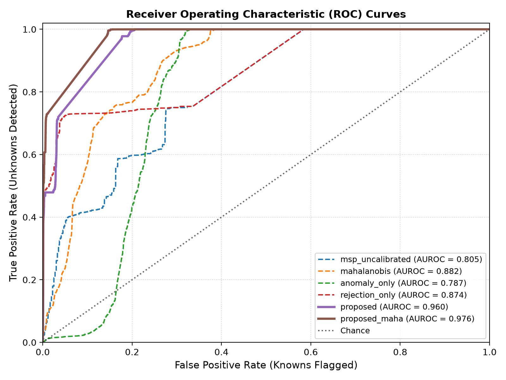
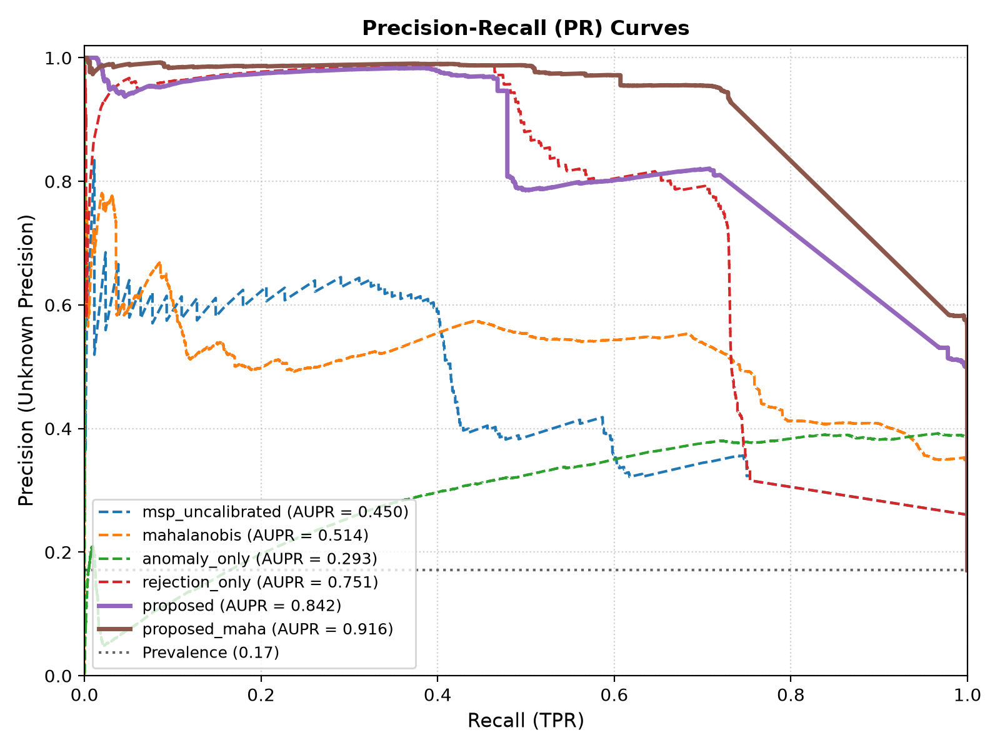
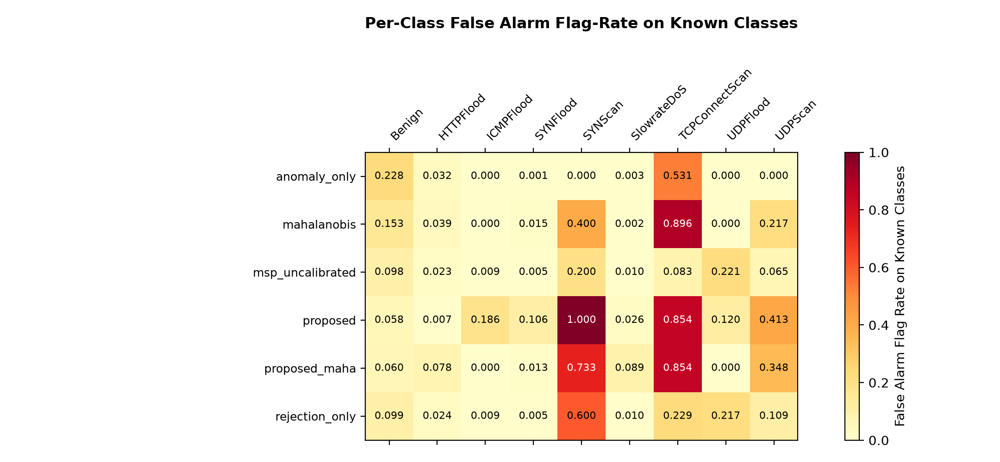
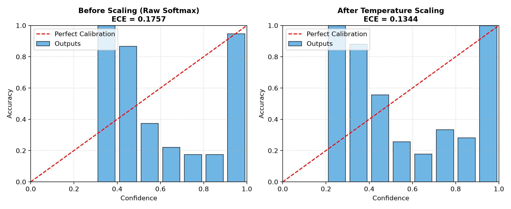
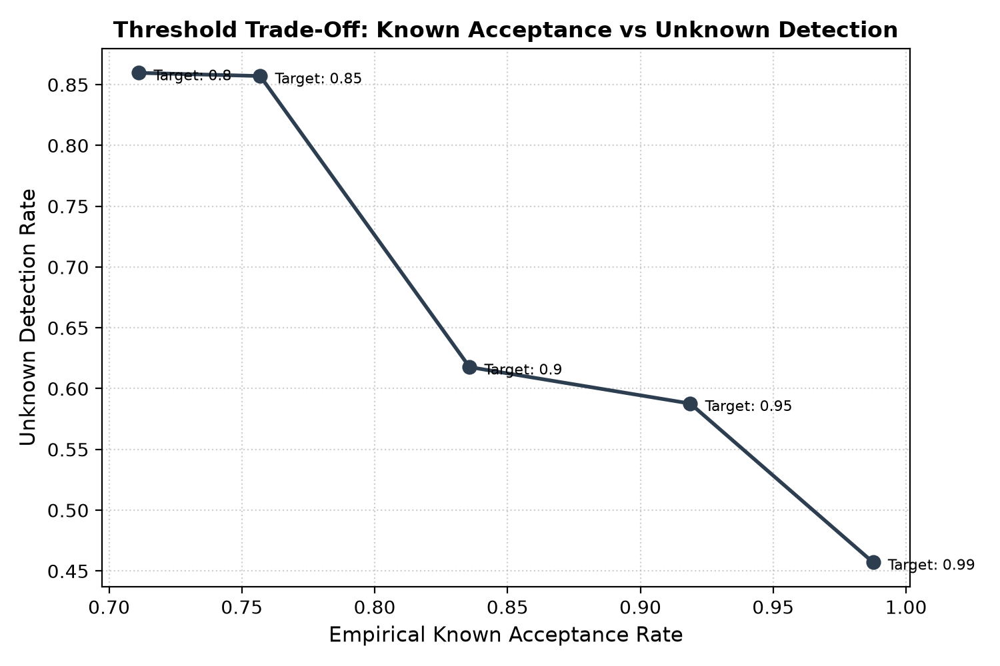

# Experiment Evaluation Report

Source Results Directory: `results_pilot_final`

Model: `rf`

## 1. Overall Open-Set Detection Performance

Averaged across all holdout families and random seeds.

| Method | Auroc | Aupr | Unknown Precision | Unknown Detection Rate | Known Fpr | Open Set F1 |
| --- | --- | --- | --- | --- | --- | --- |
| **anomaly_only** | 0.8011 ± 0.0805 | 0.2297 ± 0.3142 | 0.0524 ± 0.0646 | 0.1918 ± 0.2421 | 0.1016 ± 0.0059 | 0.6374 ± 0.0727 |
| **classifier_only** | — | — | 0.0000 ± 0.0000 | 0.0000 ± 0.0000 | 0.0000 ± 0.0000 | 0.6857 ± 0.0592 |
| **energy** | n/a: no logits | n/a: no logits | n/a: no logits | n/a: no logits | n/a: no logits | n/a: no logits |
| **mahalanobis** | 0.9149 ± 0.0541 | 0.4235 ± 0.4058 | 0.3664 ± 0.4861 | 0.6207 ± 0.4373 | 0.0720 ± 0.0095 | 0.6537 ± 0.0780 |
| **msp_uncalibrated** | 0.7730 ± 0.0682 | 0.2963 ± 0.4088 | 0.3776 ± 0.5264 | 0.3257 ± 0.0642 | 0.0821 ± 0.0262 | 0.7187 ± 0.0158 |
| **proposed** | 0.9622 ± 0.0312 | 0.6373 ± 0.3347 | 0.4380 ± 0.5675 | 0.7920 ± 0.0419 | 0.0586 ± 0.0231 | 0.6516 ± 0.0926 |
| **proposed_maha** | 0.9589 ± 0.0144 | 0.7600 ± 0.1802 | 0.4422 ± 0.5727 | 0.8660 ± 0.1264 | 0.0602 ± 0.0167 | 0.7019 ± 0.0379 |
| **rejection_only** | 0.8400 ± 0.0385 | 0.4573 ± 0.4778 | 0.4328 ± 0.5996 | 0.5877 ± 0.1826 | 0.0812 ± 0.0278 | 0.7457 ± 0.0211 |

## 2. Per-Family Open-Set Detection Breakdown

| Family | Method | Auroc | Aupr | Unknown Precision | Unknown Detection Rate | Known Fpr | Open Set F1 |
| --- | --- | --- | --- | --- | --- | --- | --- |
| httpflood | `anomaly_only` | 0.7442 ± n/a | 0.4518 ± n/a | 0.0980 ± n/a | 0.0206 ± n/a | 0.0974 ± n/a | 0.5859 ± n/a |
| httpflood | `classifier_only` | — | — | 0.0000 ± n/a | 0.0000 ± n/a | 0.0000 ± n/a | 0.6438 ± n/a |
| httpflood | `energy` | n/a: no logits | n/a: no logits | n/a: no logits | n/a: no logits | n/a: no logits | n/a: no logits |
| httpflood | `mahalanobis` | 0.8766 ± n/a | 0.7105 ± n/a | 0.7101 ± n/a | 0.3115 ± n/a | 0.0653 ± n/a | 0.5986 ± n/a |
| httpflood | `msp_uncalibrated` | 0.7248 ± n/a | 0.5853 ± n/a | 0.7499 ± n/a | 0.3711 ± n/a | 0.0636 ± n/a | 0.7075 ± n/a |
| httpflood | `proposed` | 0.9401 ± n/a | 0.8740 ± n/a | 0.8393 ± n/a | 0.7624 ± n/a | 0.0750 ± n/a | 0.5861 ± n/a |
| httpflood | `proposed_maha` | 0.9487 ± n/a | 0.8875 ± n/a | 0.8472 ± n/a | 0.7767 ± n/a | 0.0719 ± n/a | 0.6752 ± n/a |
| httpflood | `rejection_only` | 0.8128 ± n/a | 0.7951 ± n/a | 0.8568 ± n/a | 0.7169 ± n/a | 0.0615 ± n/a | 0.7606 ± n/a |
| scans | `anomaly_only` | 0.8580 ± n/a | 0.0075 ± n/a | 0.0067 ± n/a | 0.3631 ± n/a | 0.1058 ± n/a | 0.6888 ± n/a |
| scans | `classifier_only` | — | — | 0.0000 ± n/a | 0.0000 ± n/a | 0.0000 ± n/a | 0.7275 ± n/a |
| scans | `energy` | n/a: no logits | n/a: no logits | n/a: no logits | n/a: no logits | n/a: no logits | n/a: no logits |
| scans | `mahalanobis` | 0.9531 ± n/a | 0.1365 ± n/a | 0.0226 ± n/a | 0.9299 ± n/a | 0.0787 ± n/a | 0.7088 ± n/a |
| scans | `msp_uncalibrated` | 0.8212 ± n/a | 0.0072 ± n/a | 0.0054 ± n/a | 0.2803 ± n/a | 0.1006 ± n/a | 0.7298 ± n/a |
| scans | `proposed` | 0.9843 ± n/a | 0.4006 ± n/a | 0.0367 ± n/a | 0.8217 ± n/a | 0.0423 ± n/a | 0.7171 ± n/a |
| scans | `proposed_maha` | 0.9690 ± n/a | 0.6326 ± n/a | 0.0373 ± n/a | 0.9554 ± n/a | 0.0484 ± n/a | 0.7287 ± n/a |
| scans | `rejection_only` | 0.8672 ± n/a | 0.1194 ± n/a | 0.0088 ± n/a | 0.4586 ± n/a | 0.1009 ± n/a | 0.7308 ± n/a |

## 3. Unknown Precision by Method and Family

| Method | httpflood (mean ± std) | scans (mean ± std) | Overall Mean |
| --- | --- | --- | --- |
| **anomaly_only** | 0.0980 ± n/a | 0.0067 ± n/a | 0.0524 ± 0.0646 |
| **classifier_only** | 0.0000 ± n/a | 0.0000 ± n/a | 0.0000 ± 0.0000 |
| **energy** | n/a: no logits | n/a: no logits | n/a: no logits |
| **mahalanobis** | 0.7101 ± n/a | 0.0226 ± n/a | 0.3664 ± 0.4861 |
| **msp_uncalibrated** | 0.7499 ± n/a | 0.0054 ± n/a | 0.3776 ± 0.5264 |
| **proposed** | 0.8393 ± n/a | 0.0367 ± n/a | 0.4380 ± 0.5675 |
| **proposed_maha** | 0.8472 ± n/a | 0.0373 ± n/a | 0.4422 ± 0.5727 |
| **rejection_only** | 0.8568 ± n/a | 0.0088 ± n/a | 0.4328 ± 0.5996 |

## 4. Temperature Calibration Effect

Temperature scaling parameter $T$ and Expected Calibration Error (ECE) before/after scaling.

| Family | Temperature T | ECE Raw (Before) | ECE Calibrated (After) |
| --- | --- | --- | --- |
| **httpflood** | 2.7194 ± n/a | 0.2159 ± n/a | 0.1699 ± n/a |
| **scans** | 2.2934 ± n/a | 0.1489 ± n/a | 0.1122 ± n/a |

## 5. Threshold Rejection Trade-Off (E4)

Empirical known acceptance rate and unknown detection rate across rejection thresholds.

| Target Known Accept | Empirical Known Accept Rate | Unknown Detection Rate |
| --- | --- | --- |
| **0.8** | 0.7112 ± 0.0281 | 0.8597 ± 0.1714 |
| **0.85** | 0.7569 ± 0.0691 | 0.8571 ± 0.1751 |
| **0.9** | 0.8357 ± 0.0347 | 0.6177 ± 0.1620 |
| **0.95** | 0.9188 ± 0.0278 | 0.5877 ± 0.1826 |
| **0.99** | 0.9876 ± 0.0086 | 0.4571 ± 0.0430 |

## 6. Diagnostic Figures

- 

- 

- 

- 

- 
