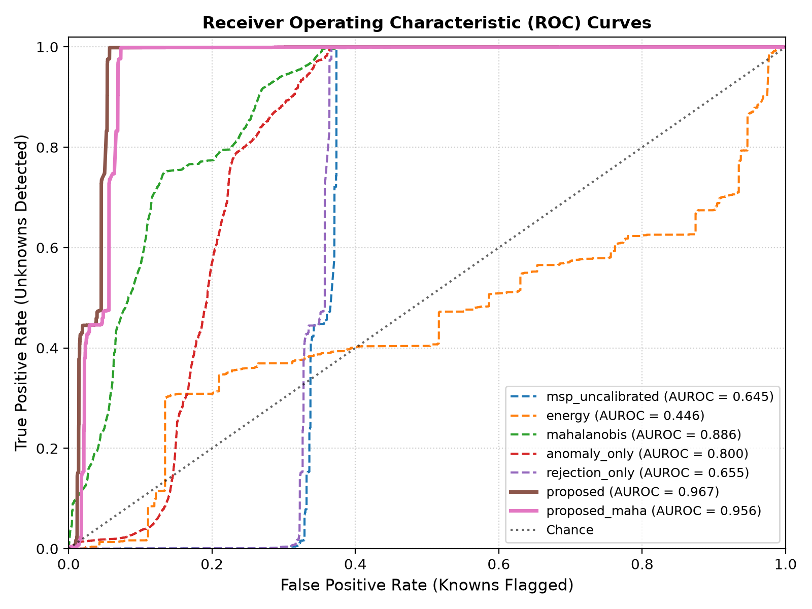
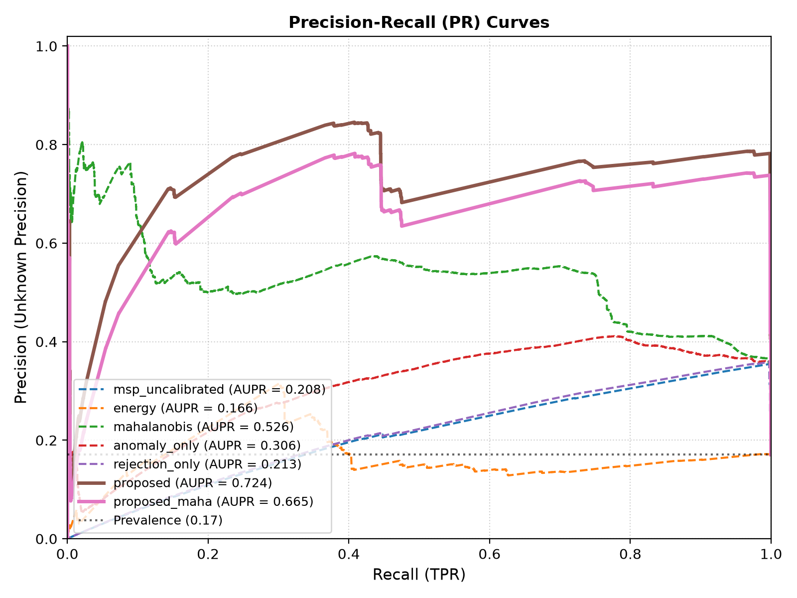
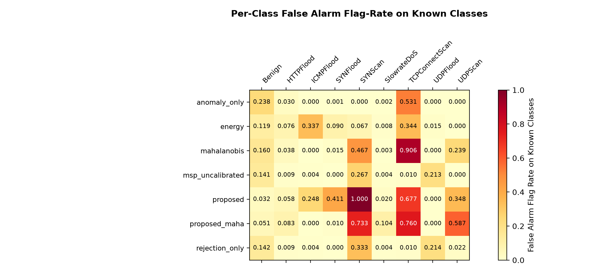
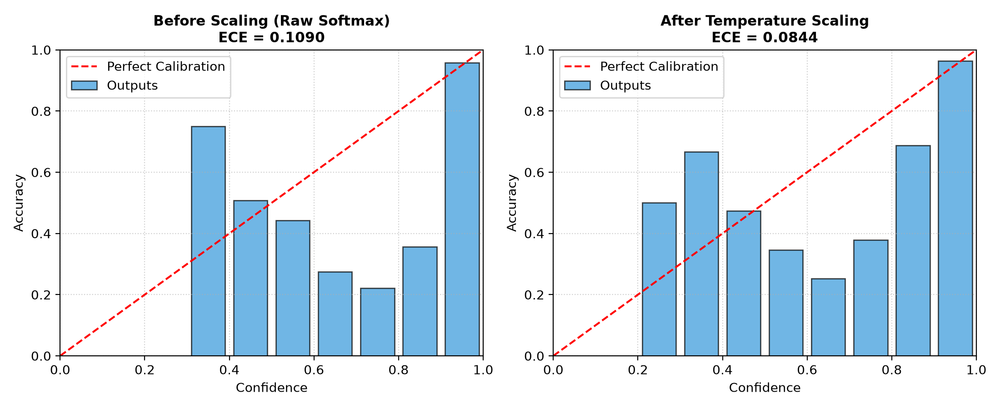
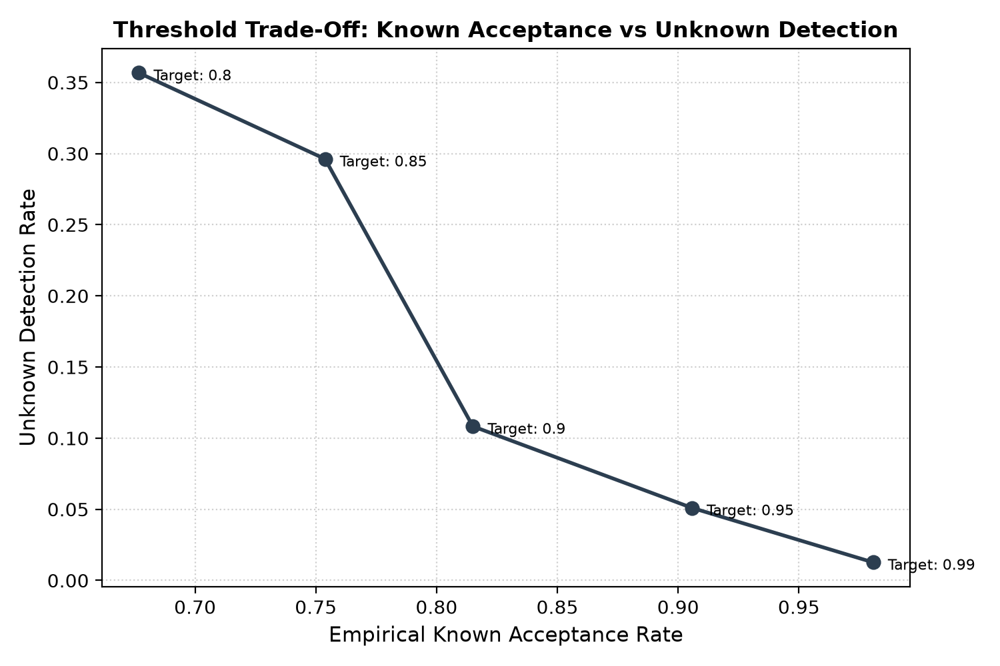

# Experiment Evaluation Report

Source Results Directory: `results_regress`

## 1. Overall Open-Set Detection Performance

Averaged across all holdout families and random seeds.

| Method | Auroc | Aupr | Unknown Precision | Unknown Detection Rate | Known Fpr | Open Set F1 |
| --- | --- | --- | --- | --- | --- | --- |
| **anomaly_only** | 0.8082 ± 0.0477 | 0.2454 ± 0.3377 | 0.0716 ± 0.0933 | 0.1773 ± 0.2086 | 0.1044 ± 0.0122 | 0.6449 ± 0.0762 |
| **classifier_only** | — | — | 0.0000 ± 0.0000 | 0.0000 ± 0.0000 | 0.0000 ± 0.0000 | 0.6974 ± 0.0635 |
| **energy** | 0.5793 ± 0.2164 | 0.1683 ± 0.2274 | 0.0331 ± 0.0379 | 0.0652 ± 0.0699 | 0.0814 ± 0.0646 | 0.6398 ± 0.0774 |
| **mahalanobis** | 0.9148 ± 0.0518 | 0.4183 ± 0.4157 | 0.3746 ± 0.4984 | 0.6443 ± 0.4039 | 0.0747 ± 0.0078 | 0.6632 ± 0.0905 |
| **msp_uncalibrated** | 0.6644 ± 0.0887 | 0.1917 ± 0.2477 | 0.0008 ± 0.0012 | 0.0478 ± 0.0676 | 0.0935 ± 0.0305 | 0.6875 ± 0.0655 |
| **proposed** | 0.9613 ± 0.0235 | 0.6118 ± 0.3048 | 0.4298 ± 0.5329 | 0.6929 ± 0.3533 | 0.0438 ± 0.0152 | 0.6371 ± 0.1623 |
| **proposed_maha** | 0.9596 ± 0.0094 | 0.6395 ± 0.3285 | 0.4538 ± 0.5848 | 0.9708 ± 0.0398 | 0.0613 ± 0.0243 | 0.7280 ± 0.0301 |
| **rejection_only** | 0.6655 ± 0.0884 | 0.1985 ± 0.2411 | 0.0009 ± 0.0012 | 0.0510 ± 0.0721 | 0.0943 ± 0.0292 | 0.6880 ± 0.0649 |

## 2. Per-Family Open-Set Detection Breakdown

| Family | Method | Auroc | Aupr | Unknown Precision | Unknown Detection Rate | Known Fpr | Open Set F1 |
| --- | --- | --- | --- | --- | --- | --- | --- |
| httpflood | `anomaly_only` | 0.7745 ± n/a | 0.4842 ± n/a | 0.1376 ± n/a | 0.0298 ± n/a | 0.0958 ± n/a | 0.5910 ± n/a |
| httpflood | `classifier_only` | — | — | 0.0000 ± n/a | 0.0000 ± n/a | 0.0000 ± n/a | 0.6526 ± n/a |
| httpflood | `energy` | 0.4263 ± n/a | 0.3291 ± n/a | 0.0599 ± n/a | 0.0158 ± n/a | 0.1271 ± n/a | 0.5851 ± n/a |
| httpflood | `mahalanobis` | 0.8782 ± n/a | 0.7122 ± n/a | 0.7271 ± n/a | 0.3588 ± n/a | 0.0692 ± n/a | 0.5992 ± n/a |
| httpflood | `msp_uncalibrated` | 0.6017 ± n/a | 0.3669 ± n/a | 0.0000 ± n/a | 0.0000 ± n/a | 0.0719 ± n/a | 0.6411 ± n/a |
| httpflood | `proposed` | 0.9447 ± n/a | 0.8273 ± n/a | 0.8065 ± n/a | 0.4431 ± n/a | 0.0546 ± n/a | 0.5223 ± n/a |
| httpflood | `proposed_maha` | 0.9662 ± n/a | 0.8718 ± n/a | 0.8673 ± n/a | 0.9989 ± n/a | 0.0785 ± n/a | 0.7067 ± n/a |
| httpflood | `rejection_only` | 0.6030 ± n/a | 0.3690 ± n/a | 0.0000 ± n/a | 0.0000 ± n/a | 0.0736 ± n/a | 0.6421 ± n/a |
| scans | `anomaly_only` | 0.8419 ± n/a | 0.0066 ± n/a | 0.0056 ± n/a | 0.3248 ± n/a | 0.1130 ± n/a | 0.6987 ± n/a |
| scans | `classifier_only` | — | — | 0.0000 ± n/a | 0.0000 ± n/a | 0.0000 ± n/a | 0.7423 ± n/a |
| scans | `energy` | 0.7324 ± n/a | 0.0076 ± n/a | 0.0063 ± n/a | 0.1146 ± n/a | 0.0357 ± n/a | 0.6945 ± n/a |
| scans | `mahalanobis` | 0.9515 ± n/a | 0.1243 ± n/a | 0.0222 ± n/a | 0.9299 ± n/a | 0.0802 ± n/a | 0.7272 ± n/a |
| scans | `msp_uncalibrated` | 0.7271 ± n/a | 0.0165 ± n/a | 0.0016 ± n/a | 0.0955 ± n/a | 0.1150 ± n/a | 0.7338 ± n/a |
| scans | `proposed` | 0.9779 ± n/a | 0.3963 ± n/a | 0.0530 ± n/a | 0.9427 ± n/a | 0.0331 ± n/a | 0.7519 ± n/a |
| scans | `proposed_maha` | 0.9529 ± n/a | 0.4072 ± n/a | 0.0403 ± n/a | 0.9427 ± n/a | 0.0441 ± n/a | 0.7493 ± n/a |
| scans | `rejection_only` | 0.7279 ± n/a | 0.0280 ± n/a | 0.0017 ± n/a | 0.1019 ± n/a | 0.1150 ± n/a | 0.7339 ± n/a |

## 3. Unknown Precision by Method and Family

| Method | httpflood (mean ± std) | scans (mean ± std) | Overall Mean |
| --- | --- | --- | --- |
| **anomaly_only** | 0.1376 ± n/a | 0.0056 ± n/a | 0.0716 ± 0.0933 |
| **classifier_only** | 0.0000 ± n/a | 0.0000 ± n/a | 0.0000 ± 0.0000 |
| **energy** | 0.0599 ± n/a | 0.0063 ± n/a | 0.0331 ± 0.0379 |
| **mahalanobis** | 0.7271 ± n/a | 0.0222 ± n/a | 0.3746 ± 0.4984 |
| **msp_uncalibrated** | 0.0000 ± n/a | 0.0016 ± n/a | 0.0008 ± 0.0012 |
| **proposed** | 0.8065 ± n/a | 0.0530 ± n/a | 0.4298 ± 0.5329 |
| **proposed_maha** | 0.8673 ± n/a | 0.0403 ± n/a | 0.4538 ± 0.5848 |
| **rejection_only** | 0.0000 ± n/a | 0.0017 ± n/a | 0.0009 ± 0.0012 |

## 4. Temperature Calibration Effect

Temperature scaling parameter $T$ and Expected Calibration Error (ECE) before/after scaling.

| Family | Temperature T | ECE Raw (Before) | ECE Calibrated (After) |
| --- | --- | --- | --- |
| **httpflood** | 1.7110 ± n/a | 0.1372 ± n/a | 0.1049 ± n/a |
| **scans** | 1.6485 ± n/a | 0.0903 ± n/a | 0.0722 ± n/a |

## 5. Threshold Rejection Trade-Off (E4)

Empirical known acceptance rate and unknown detection rate across rejection thresholds.

| Target Known Accept | Empirical Known Accept Rate | Unknown Detection Rate |
| --- | --- | --- |
| **0.8** | 0.6767 ± 0.0186 | 0.3567 ± 0.5044 |
| **0.85** | 0.7538 ± 0.0416 | 0.2962 ± 0.4189 |
| **0.9** | 0.8150 ± 0.0787 | 0.1083 ± 0.1531 |
| **0.95** | 0.9057 ± 0.0292 | 0.0510 ± 0.0721 |
| **0.99** | 0.9807 ± 0.0116 | 0.0127 ± 0.0180 |

## 6. Diagnostic Figures

- 

- 

- 

- 

- 
