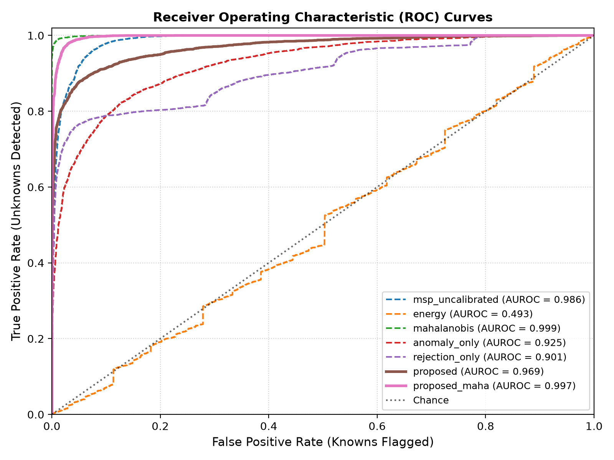
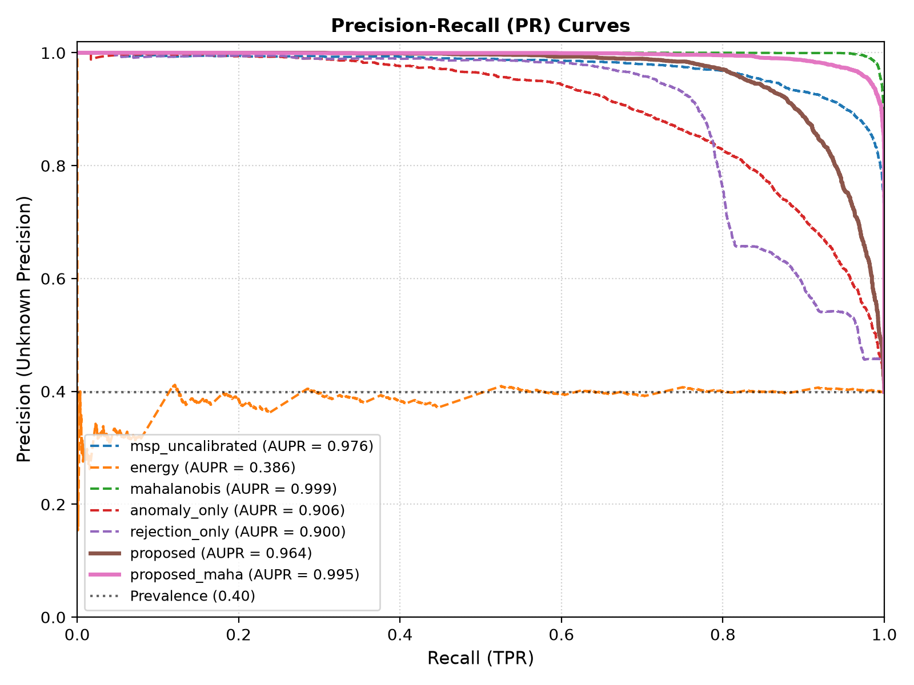
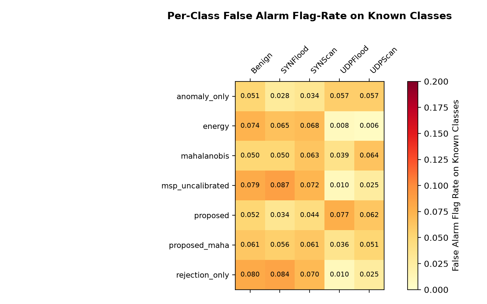
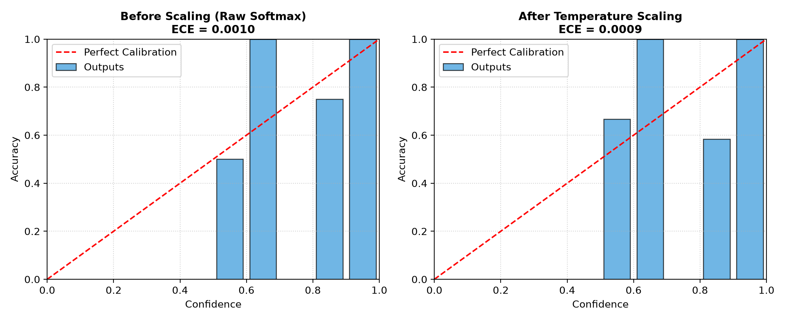
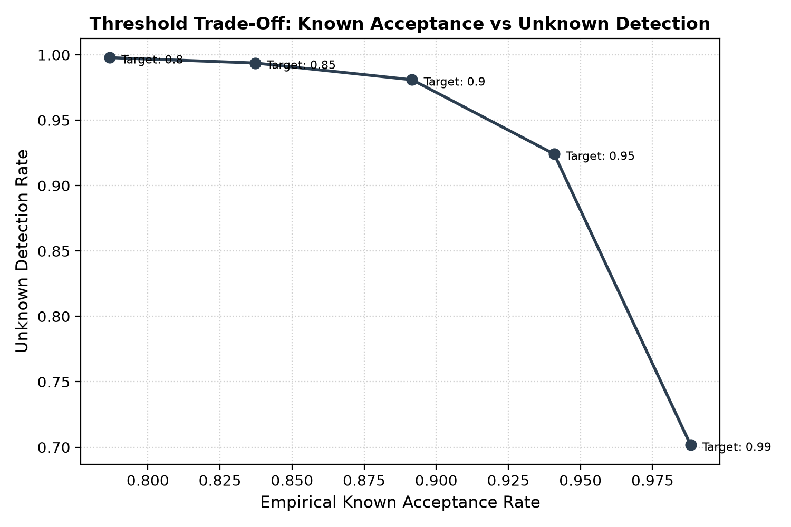

# Experiment Evaluation Report

Source Results Directory: `results_synthetic`

## 1. Overall Open-Set Detection Performance

Averaged across all holdout families and random seeds.

| Method | Auroc | Aupr | Unknown Precision | Unknown Detection Rate | Known Fpr | Open Set F1 |
| --- | --- | --- | --- | --- | --- | --- |
| **anomaly_only** | 0.9244 ± 0.0582 | 0.9037 ± 0.0678 | 0.9038 ± 0.0156 | 0.6907 ± 0.2114 | 0.0466 ± 0.0030 | 0.8554 ± 0.0847 |
| **classifier_only** | — | — | 0.0000 | 0.0000 | 0.0000 | 0.5708 ± 0.0128 |
| **energy** | 0.4932 ± 0.0115 | 0.3945 ± 0.0371 | 0.3225 ± 0.0483 | 0.0360 ± 0.0069 | 0.0506 ± 0.0097 | 0.5738 ± 0.0159 |
| **mahalanobis** | 0.9994 ± 0.0002 | 0.9992 ± 0.0003 | 0.9246 ± 0.0217 | 0.9980 ± 0.0018 | 0.0530 ± 0.0101 | 0.9687 ± 0.0069 |
| **msp_uncalibrated** | 0.9856 ± 0.0063 | 0.9735 ± 0.0140 | 0.9124 ± 0.0046 | 0.9310 ± 0.0537 | 0.0598 ± 0.0106 | 0.9418 ± 0.0138 |
| **proposed** | 0.9701 ± 0.0271 | 0.9664 ± 0.0274 | 0.9170 ± 0.0089 | 0.8851 ± 0.0978 | 0.0529 ± 0.0060 | 0.9244 ± 0.0403 |
| **proposed_maha** | 0.9966 ± 0.0024 | 0.9939 ± 0.0048 | 0.9230 ± 0.0148 | 0.9900 ± 0.0080 | 0.0546 ± 0.0096 | 0.9650 ± 0.0071 |
| **rejection_only** | 0.9853 ± 0.0066 | 0.9732 ± 0.0144 | 0.9127 ± 0.0057 | 0.9241 ± 0.0627 | 0.0591 ± 0.0103 | 0.9398 ± 0.0169 |

## 2. Per-Family Open-Set Detection Breakdown

| Family | Method | Auroc | Aupr | Unknown Precision | Unknown Detection Rate | Known Fpr | Open Set F1 |
| --- | --- | --- | --- | --- | --- | --- | --- |
| dos | `anomaly_only` | 0.9739 ± 0.0175 | 0.9609 ± 0.0262 | 0.9137 ± 0.0184 | 0.8695 ± 0.0742 | 0.0478 ± 0.0044 | 0.9273 ± 0.0256 |
| dos | `classifier_only` | — | — | 0.0000 | 0.0000 | 0.0000 | 0.5802 ± 0.0108 |
| dos | `energy` | 0.4842 ± 0.0001 | 0.3649 ± 0.0134 | 0.3403 ± 0.0341 | 0.0412 ± 0.0061 | 0.0475 ± 0.0114 | 0.5867 ± 0.0096 |
| dos | `mahalanobis` | 0.9994 ± 0.0002 | 0.9990 ± 0.0004 | 0.9060 ± 0.0019 | 0.9972 ± 0.0027 | 0.0609 ± 0.0023 | 0.9629 ± 0.0009 |
| dos | `msp_uncalibrated` | 0.9802 ± 0.0015 | 0.9614 ± 0.0017 | 0.9096 ± 0.0055 | 0.8854 ± 0.0178 | 0.0520 ± 0.0075 | 0.9301 ± 0.0016 |
| dos | `proposed` | 0.9932 ± 0.0044 | 0.9898 ± 0.0065 | 0.9165 ± 0.0122 | 0.9681 ± 0.0245 | 0.0517 ± 0.0040 | 0.9581 ± 0.0112 |
| dos | `proposed_maha` | 0.9945 ± 0.0002 | 0.9897 ± 0.0009 | 0.9121 ± 0.0030 | 0.9838 ± 0.0060 | 0.0559 ± 0.0057 | 0.9609 ± 0.0003 |
| dos | `rejection_only` | 0.9797 ± 0.0007 | 0.9608 ± 0.0008 | 0.9084 ± 0.0039 | 0.8728 ± 0.0355 | 0.0520 ± 0.0075 | 0.9260 ± 0.0075 |
| scan | `anomaly_only` | 0.8749 ± 0.0072 | 0.8465 ± 0.0035 | 0.8938 ± 0.0006 | 0.5119 ± 0.0262 | 0.0453 ± 0.0011 | 0.7834 ± 0.0134 |
| scan | `classifier_only` | — | — | 0.0000 | 0.0000 | 0.0000 | 0.5614 ± 0.0049 |
| scan | `energy` | 0.5023 ± 0.0083 | 0.4241 ± 0.0209 | 0.3047 ± 0.0675 | 0.0309 ± 0.0012 | 0.0536 ± 0.0106 | 0.5609 ± 0.0010 |
| scan | `mahalanobis` | 0.9995 ± 0.0000 | 0.9993 ± 0.0000 | 0.9432 ± 0.0042 | 0.9988 ± 0.0006 | 0.0451 ± 0.0072 | 0.9744 ± 0.0031 |
| scan | `msp_uncalibrated` | 0.9910 ± 0.0012 | 0.9856 ± 0.0009 | 0.9152 ± 0.0008 | 0.9765 ± 0.0034 | 0.0676 ± 0.0059 | 0.9534 ± 0.0052 |
| scan | `proposed` | 0.9471 ± 0.0076 | 0.9431 ± 0.0062 | 0.9175 ± 0.0092 | 0.8021 ± 0.0230 | 0.0541 ± 0.0094 | 0.8907 ± 0.0140 |
| scan | `proposed_maha` | 0.9987 ± 0.0005 | 0.9980 ± 0.0007 | 0.9339 ± 0.0133 | 0.9962 ± 0.0019 | 0.0532 ± 0.0155 | 0.9691 ± 0.0092 |
| scan | `rejection_only` | 0.9910 ± 0.0015 | 0.9856 ± 0.0003 | 0.9169 ± 0.0032 | 0.9754 ± 0.0027 | 0.0662 ± 0.0079 | 0.9537 ± 0.0060 |

## 3. Unknown Precision by Method and Family

| Method | dos (mean ± std) | scan (mean ± std) | Overall Mean |
| --- | --- | --- | --- |
| **anomaly_only** | 0.9137 ± 0.0184 | 0.8938 ± 0.0006 | 0.9038 ± 0.0156 |
| **classifier_only** | 0.0000 | 0.0000 | 0.0000 |
| **energy** | 0.3403 ± 0.0341 | 0.3047 ± 0.0675 | 0.3225 ± 0.0483 |
| **mahalanobis** | 0.9060 ± 0.0019 | 0.9432 ± 0.0042 | 0.9246 ± 0.0217 |
| **msp_uncalibrated** | 0.9096 ± 0.0055 | 0.9152 ± 0.0008 | 0.9124 ± 0.0046 |
| **proposed** | 0.9165 ± 0.0122 | 0.9175 ± 0.0092 | 0.9170 ± 0.0089 |
| **proposed_maha** | 0.9121 ± 0.0030 | 0.9339 ± 0.0133 | 0.9230 ± 0.0148 |
| **rejection_only** | 0.9084 ± 0.0039 | 0.9169 ± 0.0032 | 0.9127 ± 0.0057 |

## 4. Temperature Calibration Effect

Temperature scaling parameter $T$ and Expected Calibration Error (ECE) before/after scaling.

| Family | Temperature T | ECE Raw (Before) | ECE Calibrated (After) |
| --- | --- | --- | --- |
| **dos** | 1.5027 ± 0.6444 | 0.0013 ± 0.0012 | 0.0014 ± 0.0014 |
| **scan** | 1.0320 ± 0.5846 | 0.0012 ± 0.0003 | 0.0011 ± 0.0001 |

## 5. Threshold Rejection Trade-Off (E4)

Empirical known acceptance rate and unknown detection rate across rejection thresholds.

| Target Known Accept | Empirical Known Accept Rate | Unknown Detection Rate |
| --- | --- | --- |
| **0.8** | 0.7868 ± 0.0056 | 0.9978 ± 0.0021 |
| **0.85** | 0.8372 ± 0.0033 | 0.9937 ± 0.0050 |
| **0.9** | 0.8916 ± 0.0076 | 0.9809 ± 0.0143 |
| **0.95** | 0.9409 ± 0.0103 | 0.9241 ± 0.0627 |
| **0.99** | 0.9882 ± 0.0066 | 0.7017 ± 0.1766 |

## 6. Diagnostic Figures

- 

- 

- 

- 

- 
